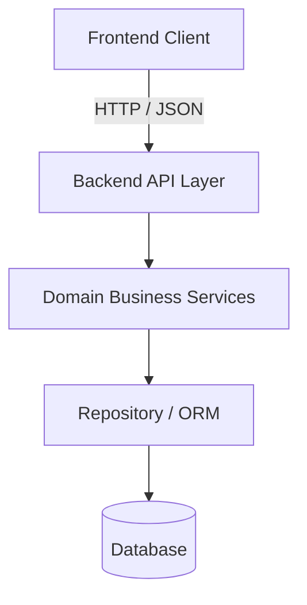
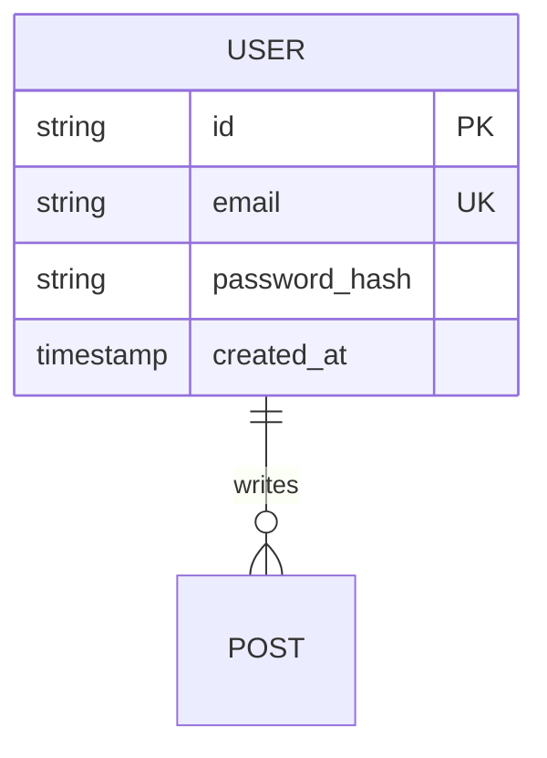

# System Architecture Document Template

```markdown
# System Architecture Specification

## 1. Executive Summary & Technology Stack
- **System Overview**: [Summary]
- **Technology Choices**:
  - Backend: [Framework, language, runtime]
  - Frontend: [Framework, styling, state management]
  - Database: [Engine, ORM/query builder]
  - Testing: [Test runners, assertion libraries]

## 2. Architecture Diagrams


## 3. Directory & Module Structure
- [Detailed file and directory layout]

## 4. Database Schema & Data Models


## 5. Security & Scalability
- Authentication strategy (JWT, session, OAuth).
- Sanitization, rate limiting, and CORS policies.
- Database connection pooling and query optimization.
```
