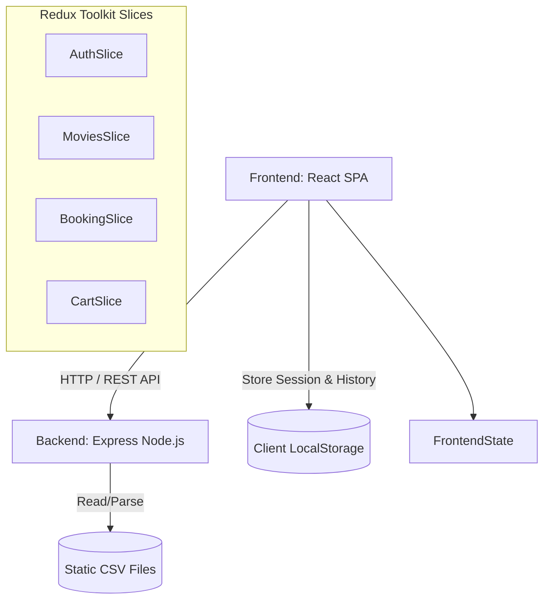
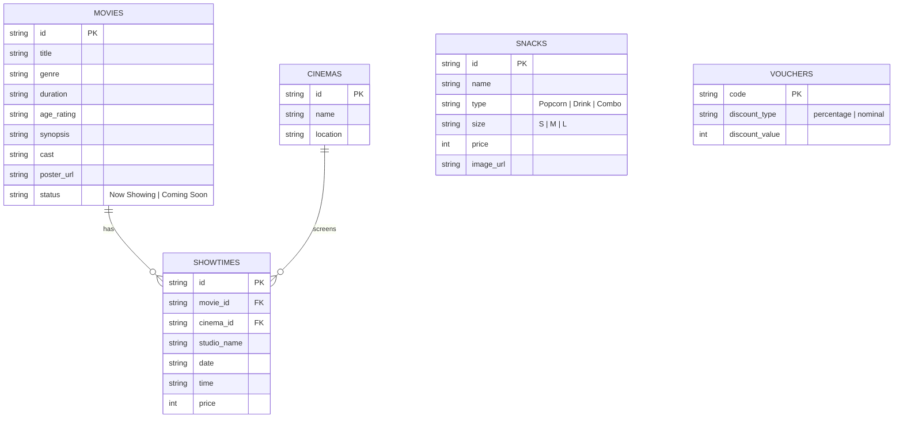

# System Architecture Specification - CineTix

## 1. Executive Summary & Tech Stack Rationale
- **Arsitektur Tingkat Tinggi (High-Level Architecture):** Aplikasi terbagi menjadi dua bagian utama: Frontend Single Page Application (SPA) dan Backend REST API. 
- **Teknologi Frontend:** React.js digunakan untuk membangun antarmuka pengguna interaktif, Redux Toolkit digunakan untuk mengelola state global, dan Tailwind CSS digunakan untuk styling (mengusung Dark Cinema Theme).
- **Teknologi Backend:** Node.js dengan framework Express.js digunakan sebagai server backend yang ringan untuk mengekspos API.
- **Database & Data Storage:** Sesuai dengan batasan persyaratan, sistem menggunakan ZERO Database (tanpa SQLite, Postgres, Mongo, dll.). Semua data master (film, jadwal, bioskop, F&B, dan promo) disimpan murni di file teks (CSV) pada backend dan dibaca secara in-memory. Penyimpanan state pengguna, transaksi/riwayat pesanan disimulasikan menggunakan LocalStorage di sisi klien.

## 2. Diagram Arsitektur & Komponen


## 3. Struktur Direktori Proyek
```text
project-root/
├── src/
│   ├── frontend/
│   │   ├── src/
│   │   │   ├── components/   # Komponen UI yang dapat digunakan ulang (Navbar, SeatMap, MovieCard)
│   │   │   ├── pages/        # Halaman utama (Home, MovieDetail, Checkout, TicketHistory)
│   │   │   ├── store/        # State management Redux
│   │   │   │   ├── authSlice.js
│   │   │   │   ├── moviesSlice.js
│   │   │   │   ├── bookingSlice.js
│   │   │   │   └── cartSlice.js
│   │   │   ├── utils/        # Helper fungsi
│   │   │   └── App.jsx       # Entry point React
│   │   ├── public/
│   │   └── package.json
│   └── backend/
│       ├── src/
│       │   ├── controllers/  # Logika request handling API
│       │   ├── routes/       # Definisi endpoint (REST API)
│       │   ├── services/     # Logika parsing CSV
│       │   │   └── csvParser.js
│       │   └── server.js     # Entry point Node.js/Express
│       ├── data/             # Direktori penyimpanan file CSV
│       │   ├── movies.csv
│       │   ├── cinemas.csv
│       │   ├── showtimes.csv
│       │   ├── snacks.csv
│       │   └── vouchers.csv
│       └── package.json
└── docs/                     # Dokumentasi proyek
```

## 4. Skema Basis Data & Model Relasi (Mock Database)
Meskipun tidak ada database yang digunakan, tabel-tabel di bawah ini merepresentasikan struktur data yang ada di file CSV masing-masing.



## 5. Keamanan & Skalabilitas (Security & Scalability)
- **Autentikasi & Otorisasi:** Sistem autentikasi dilakukan murni di klien. Tidak ada JWT/Session verifikasi pada backend karena seluruh pesanan dikelola secara lokal. Password pengguna disamarkan (hashed mock) sebelum disimpan di LocalStorage.
- **Manajemen State Frontend:** Pola Redux Toolkit digunakan dengan pembagian spesifik: `authSlice` (sesi user), `moviesSlice` (data katalog dan detail), `bookingSlice` (data pemesanan kursi berjalan), dan `cartSlice` (penggabungan pesanan kursi dan F&B).
- **Strategi Parsing CSV (Backend):** Backend akan menggunakan modul parser CSV yang efisien (seperti `csv-parser` atau eksekusi sederhana `String.prototype.split` jika file kecil). Data dari CSV akan dimuat dan di-cache (in-memory caching) ke dalam variabel ketika server pertama kali dinyalakan agar performa endpoint tetap berada di bawah respons 500ms, serta menghindari parsing ulang pada setiap request.
- **Error & Edge Handling:** Frontend mengandalkan validasi di sisi klien yang ketat. Jika terjadi error di backend (contoh: format CSV korup, file hilang), backend akan menangkap *exception* tersebut dan mengembalikan status code 500 secara _graceful_ sehingga tidak mematikan server. Frontend kemudian akan menampilkan pesan error ramah (UI error state).
