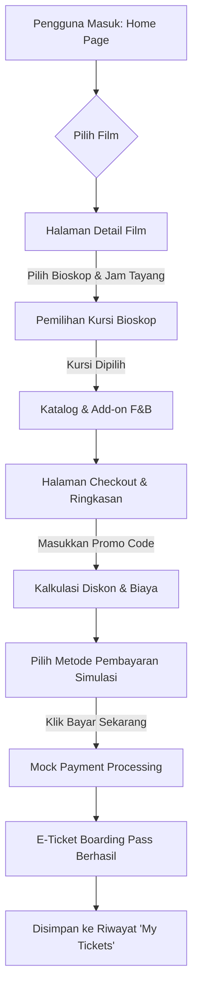

# UI/UX Design Specification & Design System — CineTix

**Document Version:** 1.0.0  
**Status:** Approved for Implementation  
**Design Theme:** Dark Luxury Cinema  
**Target Platform:** Responsive Web (Desktop, Tablet, Mobile)  
**Conformance:** WCAG 2.1 Level AA  

---

## 1. Design Philosophy & Brand Tone

### 1.1 Brand Vision & Atmosphere
**CineTix** menghadirkan pengalaman digital pemesanan tiket bioskop bertaraf premium dengan konsep **"Dark Luxury Cinema"**. Tema ini menggabungkan atmosfer redup ruang teater bioskop eksklusif dengan sentuhan visual mewah (gold & crimson), memberikan nuansa teatrikal yang elegan sejak layar pertama dimuat.

### 1.2 Core Design Principles
1. **Theatrical Immersion (Dark Canvas):**
   - Latar belakang mengadopsi palet hitam-pekat bernuansa biru ruang angkasa (*Deep Slate / Zinc 950*), mengurangi *eye strain* dalam kondisi pencahayaan rendah dan menonjolkan poster serta trailer film dengan kontras dramatis.
2. **Prestige Accents (Amber Gold & Neon Crimson):**
   - Warna aksen utama terinspirasi oleh lampu proyektor klasik dan plakat penghargaan bioskop (*Cinema Amber Gold* `#F59E0B`), dipadukan dengan aksen dinamis merah neon (*Neon Crimson* `#E11D48`) untuk penanda status penting (*urgency*, *seats sold*, atau *live promos*).
3. **Glassmorphism & Depth Elevation:**
   - Elemen kartu dan bilah navigasi menggunakan permukaan semi-transparan dengan efek blur (*backdrop-blur-md*), batas tipis berkilau (*subtle frosted borders*), dan pendaran cahaya (*glow shadows*), menciptakan ilusi kaca akrilik modern di depan layar bioskop.
4. **Frictionless Ticket & Seat Flow:**
   - Visualisasi denah kursi dibuat intuitif, interaktif, dan akurat; transisi pemilihan jadwal, kursi, hingga katalog camilan (F&B) dirancang mengalir mulus tanpa *cognitive overload*.
5. **Universal Readability & Accessibility:**
   - Setiap elemen teks memenuhi rasio kontras minimum WCAG 2.1 AA (> 4.5:1), dengan target sentuh (*touch target*) minimal 44×44px untuk kenyamanan perangkat layar sentuh.

---

## 2. Design Tokens

### A. Color Palette

#### 1. Brand & Accent Colors
| Token Name | Hex Code | RGB | Tailwind Class | Semantic Usage |
| :--- | :--- | :--- | :--- | :--- |
| **brand-amber-500** | `#F59E0B` | `rgb(245, 158, 11)` | `bg-amber-500` / `text-amber-500` | Primary Brand Color, tombol aksi utama (CTA), status Selected Seat, rating stars |
| **brand-amber-400** | `#FBBF24` | `rgb(251, 191, 36)` | `bg-amber-400` / `text-amber-400` | Hover state tombol primer, sorotan judul, curved screen glow |
| **brand-amber-600** | `#D97706` | `rgb(217, 119, 6)` | `bg-amber-600` / `text-amber-600` | Active state tombol primer, VIP Seat border/accent |
| **brand-crimson-600**| `#E11D48` | `rgb(225, 29, 72)` | `bg-rose-600` / `text-rose-600` | Secondary Brand Color, badge Now Showing, Couple Seat accent, live promo badge |
| **brand-crimson-500**| `#F43F5E` | `rgb(244, 63, 94)` | `bg-rose-500` / `text-rose-500` | Hover state crimson accent, highlight warning alert |

#### 2. Dark Neutral & Surface Colors
| Token Name | Hex Code | RGB | Tailwind Class | Semantic Usage |
| :--- | :--- | :--- | :--- | :--- |
| **bg-base** | `#090D16` | `rgb(9, 13, 22)` | `bg-[#090D16]` | Background kanvas aplikasi utama |
| **bg-surface-dark** | `#0F172A` | `rgb(15, 23, 42)` | `bg-slate-900` | Background container sekunder, dropdown menus, modal backdrop |
| **bg-surface-glass**| `rgba(30, 41, 59, 0.70)` | `rgba(30, 41, 59, 0.7)` | `bg-slate-800/70 backdrop-blur-md` | Glassmorphism cards, floating summary bar, navbar |
| **bg-surface-elevated** | `#1E293B` | `rgb(30, 41, 59)` | `bg-slate-800` | Kartu film, kartu snack, modal popover |
| **border-subtle** | `rgba(255, 255, 255, 0.08)` | `rgba(255, 255, 255, 0.08)` | `border-white/10` | Border tipis kartu glassmorphism & divider |
| **border-active** | `#334155` | `rgb(51, 65, 85)` | `border-slate-700` | Border default form input, regular seat border |
| **border-highlight**| `#F59E0B` | `rgb(245, 158, 11)` | `border-amber-500` | Border fokus input, kartu terpilih, selected seat ring |

#### 3. Text & Typography Colors
| Token Name | Hex Code | Tailwind Class | Semantic Usage |
| :--- | :--- | :--- | :--- |
| **text-primary** | `#F8FAFC` (Slate 50) | `text-slate-50` | Heading H1-H3, label penting, nama film, harga total |
| **text-secondary** | `#CBD5E1` (Slate 300) | `text-slate-300` | Body copy, sinopsis, instruksi pembayaran |
| **text-muted** | `#94A3B8` (Slate 400) | `text-slate-400` | Caption, metadata (durasi, cast), placeholder, breadcrumbs |
| **text-gold** | `#FCD34D` (Amber 300) | `text-amber-300` | Highlight harga tiket, label VIP, nomor kursi terpilih |
| **text-dark** | `#090D16` | `text-[#090D16]` | Teks kontras tinggi di atas tombol primer Amber Gold |

#### 4. Semantic Status Colors
| Status | Hex Code | Tailwind Token | Semantic Usage |
| :--- | :--- | :--- | :--- |
| **Success** | `#10B981` | `bg-emerald-500` / `text-emerald-400` | Pembayaran sukses, voucher valid, kursi tersedia |
| **Warning** | `#F59E0B` | `bg-amber-500` / `text-amber-400` | Sisa kursi tinggal sedikit (< 5 kursi), konfirmasi pending |
| **Error** | `#EF4444` | `bg-red-500` / `text-red-400` | Voucher tidak valid, validasi form gagal, kursi sudah terjual |
| **Info** | `#38BDF8` | `bg-sky-500` / `text-sky-400` | Informasi studio, instruksi pengambilan F&B |

#### 5. Seat Matrix Colors
| Seat State / Type | Fill Hex | Border Hex | Text Hex | Visual State & Class |
| :--- | :--- | :--- | :--- | :--- |
| **Regular - Available** | `#1E293B` | `#475569` | `#E2E8F0` | `bg-slate-800 border-slate-600 hover:border-amber-400 hover:bg-slate-700` |
| **VIP - Available** | `rgba(217, 119, 6, 0.15)` | `#D97706` | `#FDE68A` | `bg-amber-950/40 border-amber-600 hover:border-amber-400 hover:bg-amber-900/60` |
| **Couple - Available** | `rgba(225, 29, 72, 0.15)` | `#E11D48` | `#FECDD3` | `bg-rose-950/40 border-rose-600 hover:border-rose-400 hover:bg-rose-900/60` |
| **Selected (All Types)** | `#F59E0B` | `#FBBF24` | `#090D16` | `bg-amber-500 border-amber-400 text-slate-950 font-bold shadow-[0_0_12px_rgba(245,158,11,0.6)]` |
| **Sold / Reserved** | `#0F172A` | `#1E293B` | `#475569` | `bg-slate-900/80 border-slate-800 text-slate-600 cursor-not-allowed opacity-60` |

#### 6. Color Contrast Validation (WCAG 2.1 AA)
| Foreground Token | Background Token | Ratio | Status |
| :--- | :--- | :--- | :--- |
| Text Primary (`#F8FAFC`) | Background Base (`#090D16`) | **18.2:1** | PASS (AAA) |
| Text Primary (`#F8FAFC`) | Surface Glass (`#1E293B`) | **12.4:1** | PASS (AAA) |
| Text Secondary (`#CBD5E1`) | Background Base (`#090D16`) | **12.9:1** | PASS (AAA) |
| Text Muted (`#94A3B8`) | Surface Glass (`#1E293B`) | **5.3:1** | PASS (AA) |
| Dark Text (`#090D16`) | Amber Button (`#F59E0B`) | **9.6:1** | PASS (AAA) |
| Amber Text (`#FCD34D`) | Background Base (`#090D16`) | **13.5:1** | PASS (AAA) |
| Error Text (`#F87171`) | Surface Glass (`#1E293B`) | **4.9:1** | PASS (AA) |
| Success Text (`#34D399`) | Surface Glass (`#1E293B`) | **7.8:1** | PASS (AAA) |

---

### B. Typography Scale

- **Primary Font Family:** `'Plus Jakarta Sans'`, `'Inter'`, `-apple-system`, `BlinkMacSystemFont`, `'Segoe UI'`, `Roboto`, `sans-serif`
- **Monospace Font (Ticket Codes & Seats):** `'JetBrains Mono'`, `'Fira Code'`, `'Courier New'`, `monospace`

| Type Style | Size (Desktop / Mobile) | Weight | Line Height | Tracking | Tailwind Utility Classes |
| :--- | :--- | :--- | :--- | :--- | :--- |
| **Display / Hero H1** | 48px (3rem) / 32px (2rem) | 800 (ExtraBold) | 1.15 | `-0.025em` | `text-3xl md:text-5xl font-extrabold tracking-tight text-white` |
| **Section Title H2** | 30px (1.875rem) / 24px (1.5rem) | 700 (Bold) | 1.25 | `-0.02em` | `text-2xl md:text-3xl font-bold tracking-tight text-slate-50` |
| **Card / Subhead H3** | 20px (1.25rem) / 18px (1.125rem)| 600 (SemiBold) | 1.35 | `-0.01em` | `text-lg md:text-xl font-semibold text-slate-100` |
| **Body Large / Lead** | 18px (1.125rem) / 16px (1rem) | 400 (Regular) | 1.6 | `normal` | `text-base md:text-lg text-slate-300 leading-relaxed` |
| **Body Regular** | 16px (1rem) / 15px (0.938rem) | 400 (Regular) | 1.5 | `normal` | `text-sm md:text-base text-slate-300` |
| **Body Small / Meta** | 14px (0.875rem) / 13px (0.813rem) | 500 (Medium) | 1.45 | `normal` | `text-xs md:text-sm text-slate-400` |
| **Caption / Badge** | 12px (0.75rem) / 11px (0.688rem) | 700 (Bold) | 1.2 | `+0.05em` | `text-[11px] md:text-xs font-bold uppercase tracking-wider` |
| **Ticket Mono Code** | 14px (0.875rem) / 13px (0.813rem) | 600 (SemiBold) | 1.4 | `+0.08em` | `font-mono text-xs md:text-sm tracking-widest` |

---

### C. Spacing Scale (8pt System)
| Token | Value | Tailwind Class | Typical Usage |
| :--- | :--- | :--- | :--- |
| `space-1` | 4px | `p-1`, `gap-1` | Micro-spacing, seat gap mobile, badge padding |
| `space-2` | 8px | `p-2`, `gap-2` | Inner button padding (compact), seat gap desktop |
| `space-3` | 12px | `p-3`, `gap-3` | Input field vertical padding, tag list gap |
| `space-4` | 16px | `p-4`, `gap-4` | Standard card internal padding, button horizontal padding |
| `space-6` | 24px | `p-6`, `gap-6` | Modal container padding, section grid gap |
| `space-8` | 32px | `p-8`, `gap-8` | Large card padding, page container gutter |
| `space-12` | 48px | `py-12`, `mb-12` | Section vertical rhythm separation |
| `space-16` | 64px | `py-16`, `mb-16` | Hero section gutter, footer top spacing |

---

### D. Radii, Shadows, Glows & Glassmorphism

#### 1. Border Radii
- **`rounded-sm` (4px):** Seat buttons, micro tags, status dots.
- **`rounded-md` (8px):** Form input field, size selection pills, counter buttons.
- **`rounded-lg` (12px):** Action buttons, checkout summary inner boxes.
- **`rounded-xl` (16px):** Movie cards, snack catalog cards, modal dialogues.
- **`rounded-2xl` (24px):** E-Ticket container, Hero featured banner card.
- **`rounded-full` (9999px):** Badges, category filter pills, circular avatar, round icons.

#### 2. Elevation & Glow Effects
```css
/* Custom Glow & Shadow Tokens */
--elevation-card: 0 10px 30px -5px rgba(0, 0, 0, 0.6);
--elevation-modal: 0 25px 50px -12px rgba(0, 0, 0, 0.85);

--glow-amber: 0 0 20px rgba(245, 158, 11, 0.45);
--glow-amber-strong: 0 0 35px rgba(245, 158, 11, 0.70);
--glow-crimson: 0 0 20px rgba(225, 29, 72, 0.40);
--glow-screen: 0 -12px 35px rgba(245, 158, 11, 0.35);

/* Tailwind Glass Surface Utility */
.glass-panel {
  background: rgba(30, 41, 59, 0.65);
  backdrop-filter: blur(16px);
  -webkit-backdrop-filter: blur(16px);
  border: 1px solid rgba(255, 255, 255, 0.08);
}

.glass-panel-hover:hover {
  background: rgba(30, 41, 59, 0.85);
  border-color: rgba(245, 158, 11, 0.4);
  box-shadow: 0 10px 25px -5px rgba(0, 0, 0, 0.5), 0 0 15px rgba(245, 158, 11, 0.2);
}
```

---

## 3. Komponen Antarmuka & State Matrix

### A. Button Component System

| Variant | State | Background | Text Color | Border | Glow / Shadow | Tailwind Classes |
| :--- | :--- | :--- | :--- | :--- | :--- | :--- |
| **Primary (Amber)** | Default | `#F59E0B` | `#090D16` | None | `shadow-md` | `bg-amber-500 text-slate-950 font-bold px-5 py-2.5 rounded-lg transition-all` |
| | Hover | `#FBBF24` | `#090D16` | None | `shadow-[0_0_20px_rgba(245,158,11,0.5)]` | `hover:bg-amber-400 hover:shadow-[0_0_20px_rgba(245,158,11,0.5)]` |
| | Active | `#D97706` | `#090D16` | None | `scale-[0.98]` | `active:bg-amber-600 active:scale-[0.98]` |
| | Focus | `#F59E0B` | `#090D16` | Ring 2px | `ring-2 ring-amber-300 ring-offset-2 ring-offset-[#090D16]` | `focus-visible:outline-none focus-visible:ring-2 focus-visible:ring-amber-300 focus-visible:ring-offset-2 focus-visible:ring-offset-slate-950` |
| | Disabled| `#334155` | `#64748B` | None | None | `disabled:bg-slate-700 disabled:text-slate-500 disabled:cursor-not-allowed disabled:shadow-none` |
| | Loading | `#F59E0B` | Transparent | None | `animate-pulse` | `opacity-80 cursor-wait` (Tampilkan SVG spinner di tengah) |
| **Secondary (Outline)** | Default | Transparent| `#F8FAFC` | 1px Solid `#475569` | None | `bg-transparent border border-slate-600 text-slate-100 hover:border-amber-400 hover:text-amber-400 rounded-lg px-5 py-2.5 transition-all` |
| | Hover | `rgba(245,158,11,0.1)` | `#FBBF24` | 1px Solid `#F59E0B` | `shadow-[0_0_12px_rgba(245,158,11,0.2)]` | `hover:bg-amber-500/10 hover:border-amber-400 hover:text-amber-300` |
| **Danger / Crimson** | Default | `#E11D48` | `#FFFFFF` | None | `shadow-md` | `bg-rose-600 hover:bg-rose-500 text-white font-semibold rounded-lg px-5 py-2.5 shadow-md transition-all` |
| **Ghost / Icon** | Default | Transparent| `#94A3B8` | None | None | `text-slate-400 hover:text-white hover:bg-slate-800/60 p-2 rounded-lg transition-colors` |

---

### B. Form Inputs System (Text Field, Select, Counter)

#### 1. Text Field & Search Input
- **Default:** `bg-slate-900/90 border border-slate-700 text-slate-100 placeholder:text-slate-500 rounded-lg px-4 py-2.5 focus:border-amber-400 focus:ring-1 focus:ring-amber-400 transition-colors w-full`
- **Active / Focused:** Border berubah ke Amber Gold (`#F59E0B`), pendaran halus `shadow-[0_0_10px_rgba(245,158,11,0.2)]`.
- **Error State:** Border berubah ke Red (`#EF4444`), pesan bantuan di bawah input `text-xs text-red-400 mt-1 flex items-center gap-1`.
- **Disabled State:** `bg-slate-800/40 border-slate-800 text-slate-600 cursor-not-allowed`.

#### 2. Cinema & Date Select Dropdown
- **Trigger Element:** Kontainer rounded-lg dengan ikon pin lokasi / kalender, teks bioskop aktif, dan chevron down.
- **Dropdown Menu:** `absolute mt-2 w-full bg-slate-900/95 backdrop-blur-xl border border-slate-700/80 rounded-xl shadow-2xl p-2 z-50`.
- **Item Hover:** `hover:bg-amber-500/15 hover:text-amber-300 text-slate-200 rounded-lg px-3 py-2 text-sm cursor-pointer transition-colors`.

#### 3. Quantity Counter `[-] [Count] [+]` (F&B Stepper)
- **Container:** `inline-flex items-center bg-slate-900 border border-slate-700 rounded-lg p-1 gap-2`
- **Minus Button:** `w-7 h-7 flex items-center justify-center rounded-md bg-slate-800 hover:bg-slate-700 text-slate-300 active:scale-95 disabled:opacity-40 disabled:cursor-not-allowed`
- **Value Badge:** `w-6 text-center text-sm font-bold text-amber-400`
- **Plus Button:** `w-7 h-7 flex items-center justify-center rounded-md bg-amber-500 hover:bg-amber-400 text-slate-950 font-bold active:scale-95`

---

### C. Navbar & Navigation Component

```
+---------------------------------------------------------------------------------------------------------+
| [CineTix Logo (Reel + Gold)]   [Location: Grand Mall v]    [Q Search movies...]    [Cart (2)] [Sign In] |
+---------------------------------------------------------------------------------------------------------+
```

1. **Brand Identity:**
   - Logo: Ikon proyektor film bercahaya emas + Teks `Cine` (putih) `Tix` (gradien Amber Gold `#F59E0B`).
   - Tautan navigasi utama: *Now Showing*, *Coming Soon*, *Snacks*, *Promos*.
2. **Cinema Location Selector:**
   - Dropdown instan di navbar untuk memilih lokasi bioskop (`cinemas.csv`), disimpan di Redux/LocalStorage, menyaring jadwal tayang otomatis.
3. **Interactive Search Input:**
   - Input pill dengan ikon *Magnifying Glass*, tombol `x` untuk reset pencarian seketika, dan auto-suggest popup film relevan.
4. **Cart Badge Indicator:**
   - Ikon tiket / keranjang belanja dengan *pulsing notification badge* (`bg-rose-600 text-white text-[10px] font-bold rounded-full w-5 h-5 flex items-center justify-center -top-1 -right-1 absolute`).
   - Tooltip / popover ringkasan cepat jumlah tiket dan F&B yang sedang dipilih.
5. **Auth State Display:**
   - **Guest / Unauthenticated:** Tombol *"Sign In"* (Outline gold) memicu modal login/registrasi sederhana.
   - **Authenticated User:** Avatar inisial lingkaran (`bg-amber-500/20 text-amber-300 border border-amber-400/40`), menampilkan nama pengguna dan dropdown menu:
     - 🎟️ *"My Tickets"* (Riwayat pesanan)
     - ⚙️ *"Preferences"*
     - 🚪 *"Sign Out"* (Hapus state sesi)

---

### D. Movie Card & Hero Featured Carousel

#### 1. Hero Featured Carousel (Cinematic Banner)
- **Aspect Ratio & Frame:** 21:9 (Desktop banner `h-[480px]`), 16:9 (Mobile `h-[320px]`).
- **Gradient Overlay:** `bg-gradient-to-t from-[#090D16] via-[#090D16]/60 to-transparent absolute inset-0` untuk keterbacaan tipografi teks judul.
- **Metadata Badges:**
  - Age Rating Pill: `border border-amber-400/60 bg-amber-500/10 text-amber-300 text-xs px-2.5 py-1 rounded-full font-bold` (e.g. `PG-13`, `R-21`).
  - Genre Badges: `bg-slate-800/80 text-slate-300 text-xs px-2.5 py-1 rounded-full`.
  - Rating: Ikon bintang emas + skor `8.8/10`.
- **CTA Actions:**
  - Tombol Primer: *"Book Tickets Now"* (Amber Gold dengan ikon tiket).
  - Tombol Sekunder: *"Watch Trailer"* (Outline dengan ikon Play, membuka Modal Youtube Trailer).

#### 2. Movie Card Component
- **Poster Ratio:** Standar bioskop **2:3** (`aspect-[2/3]`).
- **Card Container:**
  - `relative group overflow-hidden rounded-xl bg-slate-800/60 border border-white/5 hover:border-amber-500/50 transition-all duration-300 hover:shadow-[0_12px_28px_rgba(0,0,0,0.8),0_0_16px_rgba(245,158,11,0.25)]`
- **Poster Image:**
  - `w-full h-full object-cover transition-transform duration-500 group-hover:scale-105`
- **Floating Status Badge:**
  - Posisi: Top-left `top-3 left-3`.
  - **Now Showing:** `bg-emerald-600/90 backdrop-blur-md text-white text-[11px] font-bold px-2.5 py-1 rounded-md uppercase tracking-wider shadow-md`
  - **Coming Soon:** `bg-amber-600/90 backdrop-blur-md text-white text-[11px] font-bold px-2.5 py-1 rounded-md uppercase tracking-wider shadow-md`
- **Overlay Hover Card:**
  - Pada hover di desktop, muncul gradien gelap dari bawah dengan tombol cepat *"Quick Book"* atau *"Detail Film"*.
- **Card Information Footer:**
  - Judul Film (`truncate font-semibold text-slate-100 group-hover:text-amber-400 transition-colors`).
  - Subteks: Genre & Durasi (`text-xs text-slate-400 flex items-center justify-between mt-1`).

---

### E. Interactive Seat Map Layout

```
                  =============================================
                  /        CINEMA SCREEN / LAYAR BIOSKOP      \
                  =============================================
                  \___________________________________________/

                         [ [ [ S C R E E N   G L O W ] ] ]

Row A  [A1] [A2] [A3] [A4]      (AISLE)      [A5] [A6] [A7] [A8]  (Regular)
Row B  [B1] [B2] [B3] [B4]      (AISLE)      [B5] [B6] [B7] [B8]  (Regular)
Row C  [C1] [C2] [C3] [C4]      (AISLE)      [C5] [C6] [C7] [C8]  (VIP)
Row D  [D1] [D2] [D3] [D4]      (AISLE)      [D5] [D6] [D7] [D8]  (VIP)
Row E  [   E1-E2   ] [   E3-E4   ]     [   E5-E6   ] [   E7-E8   ] (Couple)

---------------------------------------------------------------------------
Legend: (•) Available  (•) Selected [Gold]  (x) Sold [Dark]  [VIP]  [Couple]
---------------------------------------------------------------------------
Floating Bar: 2 Seats Selected: C3, C4 | Total: Rp 120.000 | [Next: Snacks ->]
```

#### 1. Screen Projection Visualization
- Garis lengkung atas bersinar:
  - `h-3 w-4/5 mx-auto border-t-4 border-amber-400/90 rounded-t-[100%] shadow-[0_-12px_28px_rgba(245,158,11,0.4)] relative`
  - Teks penanda: *"LAYAR BIOSKOP / ALL EYES ON SCREEN"* berukuran `text-[11px] text-amber-300/80 font-bold tracking-[0.3em] uppercase text-center mt-3`.

#### 2. Seat Geometry & Type Styling
1. **Regular Seat (`A1 - B8`):**
   - Ukuran: `w-9 h-9 sm:w-10 sm:h-10 rounded-md`
   - Visual: Kursi standar dengan sandaran tangan minimalis.
   - Base Price: Rp 50.000.
2. **VIP Recliner Seat (`C1 - D8`):**
   - Ukuran: `w-10 h-10 sm:w-11 sm:h-11 rounded-lg border-2 border-amber-600/70 bg-amber-950/20`
   - Visual: Ikon mahkota kecil / trim emas mewah, sandaran lebih lebar.
   - Base Price: Rp 75.000.
3. **Couple Sweetbox Seat (`Row E`):**
   - Ukuran: Mengambil 2 grid lebar (`w-20 sm:w-24 h-10 rounded-xl border-2 border-rose-600/80 bg-rose-950/25`)
   - Visual: Kursi sofa ganda tanpa pemisah tengah (*armrest-free*).
   - Base Price: Rp 140.000 (untuk sepasang).

#### 3. Interactive Behaviors & Accessibility
- **Click Behavior:**
  - Klik kursi kosong (`Available`) -> beralih ke `Selected` (Amber glow, suara/feedback haptic ringan jika di mobile), kursi ditambahkan ke Redux `bookingSlice.selectedSeats`.
  - Klik kursi yang sedang `Selected` -> *deselected* (kembali ke state awal).
  - Klik kursi `Sold` -> *Disabled*, tidak ada aksi, pointer `not-allowed`.
- **Keyboard Navigation:**
  - Tombol Tab berpindah antar kursi, tombol `Space` atau `Enter` untuk memilih/membatalkan kursi.
  - Setiap tombol kursi memiliki tag eksplisit: `aria-label="Kursi VIP C4, Harga Rp 75.000, Status Tersedia"` dan `aria-pressed="true/false"`.

#### 4. Sticky Bottom Action Bar
- Baris mengambang di bawah layar:
  - `fixed bottom-0 left-0 right-0 z-40 bg-slate-900/90 backdrop-blur-xl border-t border-slate-700/80 p-4`
  - Menampilkan ringkasan: Kursi terpilih (`C3, C4`), Studio, Total harga tiket, serta tombol primer *"Lanjut ke Camilan / Checkout"*.

---

### F. F&B Snack Catalog & Card Component

```
+------------------------------------------------------------+
| [Popcorn Image]                       [COMBO BADGE]        |
| Caramel Popcorn Large + 2 Soft Drinks                      |
| Renyah, manis karamel gurih dengan 2 soda dingin.          |
|                                                            |
| Size: (S) [M] (L)                                          |
| Rp 65.000                          [-] [ 1 ] [+]  [+ Add]  |
+------------------------------------------------------------+
```

1. **Category Navigation Tabs:**
   - Pill horizontal yang dapat di-*scroll*: *"Semua"*, *"Popcorn"*, *"Minuman"*, *"Paket Combo"*.
   - Tab aktif: `bg-amber-500 text-slate-950 font-bold shadow-[0_0_12px_rgba(245,158,11,0.3)] rounded-full px-5 py-2`.
   - Tab inaktif: `bg-slate-800 text-slate-400 hover:text-white rounded-full px-5 py-2`.
2. **Snack Card Structure:**
   - Card container: `bg-slate-800/70 border border-white/5 hover:border-amber-500/40 rounded-xl p-4 flex flex-col justify-between`.
   - Image wrapper: Rasio 4:3 dengan efek zoom halus saat disentuh/hover.
   - Size Selector Pill: Pilihan ukuran `S`, `M`, `L`. Memilih ukuran meng-update harga satuan secara otomatis.
   - Stepper Controller: Tombol `[-]` dan `[+]` dengan badge angka di tengah.
   - Add CTA: Tombol *"Tambah"* yang berubah sesaat menjadi ceklis hijau *"Ditambahkan!"*.

---

### G. Order Summary & Checkout Card Component

```
+----------------------------------------------------------------------------------+
| RINGKASAN PESANAN                                                                |
| -------------------------------------------------------------------------------- |
| [Film] Avatar: The Way of Water                                                  |
| CineTix Grand Mall • Studio 1 • 15 Okt 2023, 14:00                               |
| Kursi: C3, C4 (VIP)                                                 Rp 150.000   |
| 1x Popcorn Caramel Large                                             Rp  45.000  |
| -------------------------------------------------------------------------------- |
| Subtotal                                                             Rp 195.000  |
| Pajak PPN (11%)                                                      Rp  21.450  |
| Biaya Layanan / Admin                                                Rp   3.000  |
| Voucher Promo (PROMO20 - Diskon 20%)                                -Rp  39.000  |
| ================================================================================ |
| TOTAL PEMBAYARAN                                                     Rp 180.450  |
+----------------------------------------------------------------------------------+
| METODE PEMBAYARAN SIMULASI:                                                      |
| (•) QRIS (Instant Mock QR)    ( ) E-Wallet (GoPay/OVO)    ( ) Virtual Account    |
+----------------------------------------------------------------------------------+
| [                     BAYAR SEKARANG - RP 180.450                              ] |
+----------------------------------------------------------------------------------+
```

1. **Itemized Breakdown List:**
   - Baris tiket terpisah rapi dengan ikon proyektor/tiket kecil.
   - Baris makanan ringan dengan rincian kuantitas dan harga.
2. **Promo Code Input Box:**
   - Input horizontal dengan tombol *"Gunakan"* / *"Apply"*.
   - **Status Valid (Hijau):** Muncul alert `Voucher PROMO20 berhasil diterapkan! Hemat 20%`.
   - **Status Error (Merah):** `Kode voucher tidak valid atau sudah kadaluarsa`.
3. **Transparent Financial Calculations:**
   - Subtotal (Tiket + Snack).
   - Pajak Standar (PPN 11%).
   - Biaya Administrasi Tetap (`Rp 3.000`).
   - Diskon Promo (Warna teks hijau `#34D399` dengan tanda minus).
   - Total Akhir (`text-xl font-bold text-amber-400`).
4. **Mock Payment Selector (Radio Card Cards):**
   - **QRIS:** Menampilkan simulasi QR code dinamis beranimasi dengan instruksi "Scan via Mobile Banking / E-Wallet apa saja".
   - **E-Wallet:** Pilihan logo GoPay, OVO, ShopeePay, DANA.
   - **Virtual Account:** Pilihan bank (BCA, Mandiri, BNI, BRI) beserta dummy nomor VA (`8801-9283-1029`).
5. **Checkout CTA Button:**
   - Tombol penuh dengan teks nominal dinamis: *"Bayar Sekarang — Rp 180.450"*.
   - Saat diklik: Spinner loading 1-2 detik sebelum diarahkan ke halaman sukses / E-Ticket pass.

---

### H. E-Ticket Component (Cinema Boarding Pass)

E-Ticket dirancang mengadopsi estetika **tiket bioskop fisik klasik modern** (*perforated vintage boarding pass*) dengan aksen mewah:

```
+-----------------------------------------------------------------------------+
|  CINETIX PREMIERE PASS                                   TICKET ID: TX-84920|
|  -------------------------------------------------------------------------  |
|  MOVIE: SPIDER-MAN: NO WAY HOME                     AGE: PG-13              |
|  CINEMA: CineTix Grand Mall                         STUDIO: Studio 1        |
|  DATE: Sabtu, 15 Okt 2023                           TIME: 14:00 WIB         |
|  SEATS: [ C3 ]  [ C4 ]                              TYPE: VIP RECLINER      |
|  -------------------------------------------------------------------------  |
|  SNACK PICKUP:                                                              |
|  • 1x Popcorn Caramel (L)  • 2x Coca-Cola (M)                               |
| ( ) - - - - - - - - - - - - - - - - - - - - - - - - - - - - - - - - - - ( ) |  <-- Perforation Cutouts
|  SCAN AT GATE & SNACK BAR:                                                  |
|         +-------------+      STATUS: [ CONFIRMED & PAID ]                   |
|         |  [QR CODE]  |      Present this QR Code to the cinema usher       |
|         |  MOCK SVG   |      at Studio Entrance or F&B Counter.             |
|         +-------------+                                                     |
|         |||| | ||||| ||| ||||||| 8492-0193-8192                            |
+-----------------------------------------------------------------------------+
|  [ Download E-Ticket / Print ]                 [ Lihat di My Tickets -> ]   |
+-----------------------------------------------------------------------------+
```

#### Detail Spesifikasi Visual E-Ticket:
1. **Perforation Notches (Lekukan Tiket):**
   - Menggunakan bulatan lekukan di sisi kiri dan kanan (`w-6 h-6 rounded-full bg-[#090D16] -left-3 -right-3 absolute`) dan garis putus-putus (`border-b-2 border-dashed border-slate-700/80`).
2. **Cinema Header & Watermark:**
   - Latar belakang memiliki tekstur geometris redup dengan watermark logo bioskop samar (*low opacity watermark*).
3. **Seat Badge Prominence:**
   - Nomor kursi diletakkan di dalam kotak aksen Amber Gold terang bertekstur foil: `bg-amber-500/20 border border-amber-400 text-amber-300 font-mono text-lg font-bold px-3 py-1 rounded-md`.
4. **Mock QR Code & Barcode:**
   - Kontainer QR putih kontras tinggi dengan pola kotak-kotak SVG yang dapat dipindai simulasi.
   - Barcode strip realistis dengan teks nomor seri transaksi di bawahnya.
5. **Snack Pick-Up Voucher Section:**
   - Menampilkan daftar camilan yang dibeli untuk langsung ditukarkan di counter bioskop tanpa perlu antre tiket terpisah.
6. **Action CTA:**
   - Tombol *"Cetak / Simpan Tiket"* (memicu `window.print()` dengan CSS khusus print) dan *"Buka Tiket Saya"*.

---

## 4. Breakpoint & Layout Responsif

Sistem tata letak CineTix didesain dengan pendekatan **Mobile-First** menggunakan breakpoint standar Tailwind CSS:

| Breakpoint | Viewport Width | Karakteristik Layout & Navigasi | Strategi Seat Map & Komponen |
| :--- | :--- | :--- | :--- |
| **Mobile (`sm`)** | `< 640px` | - Single column layout.<br>- Hamburger drawer / bottom app navigation bar.<br>- Touch target minimum **44×44px**.<br>- Filter kategori F&B horizontal swipeable. | - Denah kursi otomatis dapat di-drag / horizontally scrollable dengan indikator visual pan.<br>- Sticky bottom checkout bar untuk pemesanan cepat. |
| **Tablet (`md`)** | `640px - 1023px` | - 2-column layout pada katalog film dan checkout.<br>- Modal dialog berukuran medium (`max-w-lg`). | - Denah kursi proporsional dengan skala 90%.<br>- Tampilan ringkasan pesanan bersanding dengan pemilih jadwal. |
| **Desktop (`lg` & `xl`)**| `≥ 1024px` | - Full cinematic widescreen layout (max-width `1280px`).<br>- Persistent navbar dengan input search penuh.<br>- 2-column split (65% konten interaktif, 35% sticky order summary). | - Denah kursi tampil penuh dalam satu pandangan tanpa perlu scrolling horizontal.<br>- Hover cards dengan micro-interactions & trailer preview. |

### Mobile Touch Targets & Accessibility Rule
- **Minimum Interactive Bounds:** Seluruh tombol navigasi, kontrol stepper, dan kursi bioskop memiliki batas sentuh fisik minimal **44×44px** (menggunakan padding ekstra atau pseudo-element `::after` jika ukuran visual kursi berukuran 36px).
- **Safe Area Insets:** Kontainer dioptimalkan untuk perangkat berponi/notch menggunakan kelas `pb-safe` / `env(safe-area-inset-bottom)`.

---

## 5. User Journey & Wireframe Flows

### 5.1 Diagram Alur Pengguna (User Journey Flow)



---

### 5.2 Layout Wireframes (ASCII Schematics)

#### View 1: Home & Movie Catalog View
```text
+-----------------------------------------------------------------------------------+
| [CineTix]  [Grand Mall v]   [Now Showing]  [Coming Soon]   [Q Cari...]   [Sign In]|
+-----------------------------------------------------------------------------------+
| HERO CAROUSEL: [Poster Film Unggulan - Dune Part Two]                             |
| "Perjalanan epik Paul Atreides berlanjut di Arrakis..."                           |
| [Rating: 8.9 ★] [166 Menit] [Sci-Fi/Action]                                       |
| [  Pesan Tiket Sekarang (Amber)  ]   [  Lihat Trailer (Outline)  ]                |
+-----------------------------------------------------------------------------------+
| NOW SHOWING IN CINEMAS                               [Filter Genre: Semua v]      |
| +----------------+ +----------------+ +----------------+ +----------------+      |
| | [Poster 2:3]   | | [Poster 2:3]   | | [Poster 2:3]   | | [Poster 2:3]   |      |
| | Spider-Man     | | Oppenheimer    | | Barbie         | | Past Lives     |      |
| | Action • 2j 28m| | Drama • 3j 00m | | Comedy • 1j 54m| | Romance • 1j46m|      |
| | [Pesan Tiket]  | | [Pesan Tiket]  | | [Pesan Tiket]  | | [Pesan Tiket]  |      |
| +----------------+ +----------------+ +----------------+ +----------------+      |
+-----------------------------------------------------------------------------------+
| COMING SOON (SEGERA TAYANG)                                                       |
| +----------------+ +----------------+ +----------------+ +----------------+      |
| | [Poster 2:3]   | | [Poster 2:3]   | | [Poster 2:3]   | | [Poster 2:3]   |      |
| | Deadpool 3     | | Gladiator 2    | | Joker 2        | | Moana 2        |      |
| +----------------+ +----------------+ +----------------+ +----------------+      |
+-----------------------------------------------------------------------------------+
```

#### View 2: Movie Detail & Showtime Selector
```text
+-----------------------------------------------------------------------------------+
| [ < Kembali ke Katalog ]                                                          |
| +-------------------+  SPIDER-MAN: NO WAY HOME                                    |
| |                   |  Rating: PG-13  •  Durasi: 148 Menit  •  Genre: Action, Sci-Fi  |
| |   POSTER 2:3      |  Sinopsis: Identitas Peter Parker terungkap ke dunia...      |
| |                   |  Pemeran: Tom Holland, Zendaya, Benedict Cumberbatch        |
| | [Putar Trailer ▶] |                                                             |
| +-------------------+  PILIH BIOSKOP & JADWAL TAYANG:                             |
|                        [ CineTix Grand Mall v ]    Tanggal: [Hari ini] [Besok]    |
|                        ---------------------------------------------------------- |
|                        STUDIO 1 (Reguler & VIP) - Rp 50.000                       |
|                        [ 13:00 ]  [ 15:30 (Selected) ]  [ 18:00 ]  [ 20:30 ]      |
|                        ---------------------------------------------------------- |
|                        STUDIO 2 (Premiere Couple) - Rp 140.000                    |
|                        [ 14:15 ]  [ 17:00 ]  [ 19:45 ]                            |
+-----------------------------------------------------------------------------------+
```

#### View 3: Interactive Seat Map & F&B Add-On
```text
+-----------------------------------------------------------------------------------+
| STUDIO 1 • SABTU, 15 OKT 2023 • 15:30                                             |
|                                                                                   |
|                    (================ SCREEN ================)                     |
|                                                                                   |
|    Row A  [A1] [A2] [A3] [A4]       (Aisle)       [A5] [A6] [A7] [A8]             |
|    Row B  [B1] [B2] [B3] [B4]       (Aisle)       [B5] [B6] [B7] [B8]             |
|    Row C  [C1] [C2] [C3*] [C4*]     (Aisle)       [C5] [C6] [C7] [C8]   <- VIP    |
|    Row D  [D1] [D2] [D3] [D4]       (Aisle)       [D5] [D6] [D7] [D8]   <- VIP    |
|    Row E  [   E1-E2   ] [   E3-E4   ]   [   E5-E6   ] [   E7-E8   ]     <- Couple |
|                                                                                   |
|    Legend: [ ] Tersedia  [*] Terpilih (Gold)  [X] Terjual  [VIP] Emas  [Couple]   |
+-----------------------------------------------------------------------------------+
| PILIH CAMILAN & MINUMAN (F&B)                                                     |
| [Popcorn Caramel (L)] Rp 45.000 [-][1][+]  |  [Coca-Cola (M)] Rp 20.000 [-][2][+] |
+-----------------------------------------------------------------------------------+
| [STICKY BAR] 2 Kursi: C3, C4 | Camilan: 3 Item | Total: Rp 235.000 | [Lanjut ->]  |
+-----------------------------------------------------------------------------------+
```

#### View 4: Checkout & Payment Simulation
```text
+-----------------------------------------------------------------------------------+
| CHECKOUT & PEMBAYARAN                                                             |
| +-------------------------------------------------+ +---------------------------+ |
| | 1. RINCIAN TIKET                                | | RINGKASAN BIAYA           | |
| | Spider-Man: No Way Home                         | | Tiket (2x VIP): Rp 150.000| |
| | Studio 1 • C3, C4 • 15:30 WIB                   | | F&B (3 Item):   Rp  85.000| |
| |                                                 | | Subtotal:       Rp 235.000| |
| | 2. CAMILAN                                      | | Pajak PPN 11%:  Rp  25.850| |
| | 1x Popcorn Caramel (L), 2x Cola (M)             | | Biaya Admin:    Rp   3.000| |
| |                                                 | | Diskon Promo:  -Rp  47.000| |
| | 3. KODE PROMO / VOUCHER                         | | ------------------------- | |
| | [ PROMO20           ] [ Gunakan ]               | | TOTAL:          Rp 216.850| |
| | ✓ Voucher PROMO20 Berhasil Diterapkan!          | |                           | |
| |                                                 | | METODE PEMBAYARAN:        | |
| |                                                 | | (•) QRIS (Instant)        | |
| |                                                 | | ( ) GoPay / OVO           | |
| |                                                 | | ( ) Virtual Account (BCA) | |
| |                                                 | |                           | |
| |                                                 | | [  BAYAR SEKARANG (CTA) ] | |
| +-------------------------------------------------+ +---------------------------+ |
+-----------------------------------------------------------------------------------+
```

---

## 6. Checklist Aksesibilitas (WCAG 2.1 AA Compliance)

Seluruh komponen yang dirancang dalam spesifikasi ini mematuhi standar **Web Content Accessibility Guidelines (WCAG) 2.1 Level AA**:

- [x] **Kontras Warna Teks (Contrast Ratio ≥ 4.5:1):**
  - Teks utama (`#F8FAFC`) pada latar belakang (`#090D16`) memiliki rasio **18.2:1** (Melebihi kriteria AAA).
  - Teks sekunder (`#CBD5E1`) memiliki rasio **12.9:1**.
  - Teks tombol hitam di atas aksen Amber Gold (`#F59E0B`) memiliki rasio **9.6:1**.
  - Teks label form error merah (`#F87171`) memiliki rasio **4.9:1** di atas kontainer kartu gelap.
- [x] **Indikator Fokus Visual (Focus Visible):**
  - Semua elemen interaktif (tombol, input, link, kartu kursi) wajib menyertakan ring kontras tinggi saat difokuskan melalui keyboard:
    `focus-visible:outline-none focus-visible:ring-2 focus-visible:ring-amber-400 focus-visible:ring-offset-2 focus-visible:ring-offset-slate-950`.
- [x] **Target Sentuh Layar Mobile (Touch Target Size ≥ 44×44px):**
  - Tombol kursi, kontrol kuantitas F&B, dan tab navigasi memiliki area interaksi fisik minimal 44×44 piksel.
- [x] **Label Form & ARIA Semantics:**
  - Form pencarian dan input voucher memiliki label eksplisit yang terbaca pembaca layar (*screen reader*).
  - Status validasi dinamis menggunakan atribut `aria-live="polite"` dan `role="alert"`.
- [x] **Aksesibilitas Pemilihan Kursi Bioskop:**
  - Setiap sel kursi memiliki atribut ARIA lengkap: `role="checkbox"`, `aria-checked="true/false"`, `aria-disabled="true"` (untuk kursi terjual), dan deskripsi lengkap nomor baris, tipe kursi, serta harga.
- [x] **Preferensi Gerak Pengguna (Reduced Motion):**
  - Semua transisi animasi (zoom poster, popover, pendaran glow) menghormati pengaturan pengguna dengan utilitas `motion-safe:transition-transform` dan `motion-reduce:transition-none`.

---

## 7. Pedoman Implementasi untuk Frontend Engineer

1. **Konfigurasi `tailwind.config.js`:**
   Daftarkan warna custom `cinema-amber`, `cinema-crimson`, dan `cinema-dark` serta font `Plus Jakarta Sans` ke dalam tema Tailwind.
2. **State Management Redux Toolkit:**
   - Gunakan `bookingSlice` untuk melacak `selectedShowtime`, `selectedSeats`, dan kalkulasi kursi.
   - Gunakan `cartSlice` untuk menggabungkan tiket dan camilan (`snacks`), mengelola voucher aktif, dan memproduksi total biaya.
3. **Penyimpanan Lokal (Persistence):**
   - Transaksi sukses dicatat ke `localStorage.getItem('cinetix_orders')` untuk langsung divisualisasikan pada halaman riwayat *My Tickets*.
